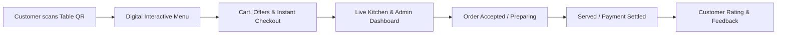

# The Dining Co. — Smart Digital Dining & Cafe Management System

Welcome to **The Dining Co.**, an all-in-one digital ordering, live kitchen management, and customer engagement platform built specifically for modern cafes, bistros, and restaurants.

---

## 1. Executive Overview

**The Dining Co.** eliminates the friction of traditional paper menus, manual order taking, and slow billing. By placing smart QR codes at every table, your customers can instantly browse your rich digital menu, customize items, apply discounts, place orders, and pay directly from their smartphone — with **zero app downloads required**.

Behind the scenes, your kitchen and counter staff receive real-time order notifications, track preparation status, manage billing, and maintain menu availability with a single click.

---

## 2. Key Benefits for Your Cafe

| Benefit | How It Helps Your Business |
| :--- | :--- |
| **Increased Average Order Value (AOV)** | High-resolution food images, categorized sections, and instant popup offers encourage upselling and add-ons. |
| **Faster Table Turnaround** | Guests order as soon as they sit down without waiting for service staff, reducing wait times by 15–25 minutes per table. |
| **Zero Miscommunication** | Customer instructions, dietary preferences, and customization notes flow directly into the kitchen without waiter errors. |
| **Real-Time Menu Control** | 86 an out-of-stock dish instantly or update pricing in seconds — no re-printing costly paper menus. |
| **Customer Retention & Loyalty** | Collect direct customer feedback, star ratings, and display tailored promotional banners and coupon codes. |

---

## 3. Core Modules & Features

### 3.1 Customer Experience (Dine-In Mobile Menu)
- **Instant Browser Access**: Guests scan a table-specific QR code to access your branded menu (`/your-cafe/menu`).
- **Interactive Visual Menu**: Filter by Category (Beverages, Snacks, Mains, Desserts, Specials), dietary tags (Veg / Non-Veg), and search dishes.
- **Smart Cart & Add-ons**: Add multiple items, adjust portions, and add special kitchen instructions.
- **Special Offers & Discounts**: Automated popup promotions highlighting today's combos or percentage discounts with single-tap coupon redemption.
- **Flexible Checkout & Tracking**: View order summary, applicable taxes/charges, select payment modes (UPI / Online / Cash at Counter), and monitor real-time order status.
- **Post-Meal Ratings & Reviews**: Seamless 5-star rating and written review collection at checkout to monitor food quality and service standards.

---

### 3.2 Kitchen & Live Order Management (Admin Dashboard)
- **Live Order Stream (`/admin/new-orders` & `/admin/orders`)**:
  - Distinct sound alerts for incoming orders.
  - Table-wise breakdown of order items, quantities, and customer instructions.
  - One-tap status updates: **Accept ➔ Preparing ➔ Ready / Served**.
- **Payment Verification (`/admin/payment-completed`)**:
  - Live tracking of paid vs. pending counter bills.
  - Clear receipts and timestamps for easy daily reconciliation.

---

### 3.3 Menu & Inventory Control (`/admin/manage-menu`)
- **Add / Edit / Remove Items**: Update dish names, descriptions, pricing, and high-definition photos powered by cloud image hosting.
- **Instant Availability Toggle**: Mark items as "Sold Out" with one click during peak hours; they immediately disappear or show unavailable on customer devices.
- **Category Organization**: Arrange categories logically to highlight your high-margin beverages, chef specials, or fast snacks.

---

### 3.4 Dynamic Offers & Promotions (`/admin/offers`)
- **Promotional Popups**: Create promotional banners that automatically greet guests when they open your menu.
- **Discount Rules**: Set percentage-based discounts or flat deductions with minimum order values and validity dates.
- **Active / Inactive Controls**: Schedule happy hours, weekend specials, or festive offers and turn them on or off instantly.

---

### 3.5 QR Code Generator (`/admin/qr-code`)
- **Table-Specific QR Codes**: Generate distinct, downloadable, high-resolution QR codes mapped to specific tables (e.g., Table 1, Table 2, Patio 5).
- **Print-Ready Formats**: Suitable for table tents, acrylic stands, or sticker mats. When scanned, the system automatically detects the exact table number.

---

### 3.6 Ratings & Analytics (`/admin/ratings` & `/admin/settings`)
- **Guest Feedback Dashboard**: Monitor daily customer satisfaction, overall ratings, and dish feedback.
- **Cafe Profile Customization**: Update cafe address, opening/closing hours, contact information, social handles, and branding logo.

---

## 4. Daily Operating Workflow

### Morning Setup (2 Minutes)
1. Staff logs into the Admin Dashboard (`/your-cafe/adminlogin`).
2. Quick check of **Manage Menu**: Toggle off any ingredients unavailable for the day.
3. Verify active **Offers** (e.g., Breakfast Combos or Happy Hours).

### Peak Hours (During Service)
1. Customer is seated and scans the Table QR code.
2. Customer selects dishes, applies any eligible offer, and taps **Place Order**.
3. Admin dashboard pings with audio notification under **New Orders**.
4. Kitchen accepts the order and marks it **Preparing**.
5. Once cooked, staff marks it **Served**.
6. When customer settles bill (online or at cash counter), mark **Payment Completed**.

### End of Day
1. Review total orders, completed transactions, and daily revenue in the order history.
2. Review customer ratings and feedback received during the shift.

---

## 5. Technical Requirements & Security

- **For Customers**: Any smartphone (iOS or Android) with a camera or QR scanner. No downloads or installations required.
- **For Cafe Staff / Counter**: Any device with a web browser — iPad, Android tablet, POS laptop, or smartphone.
- **Data Protection**: Secure authentication (`JWT`), protected staff session tokens, and encrypted database records safeguarding customer numbers and sales transactions.

---

## 6. Frequently Asked Questions (FAQ)

**Q: Do customers have to install an app from the App Store or Play Store?**  
*A: No. Scanning the QR code opens the lightweight web application immediately in Safari, Chrome, or any mobile browser.*

**Q: Can we change prices or add new dishes on the fly?**  
*A: Yes. Any change made in the Admin Menu Manager reflects immediately for any guest browsing the menu without refreshing.*

**Q: What happens if a customer wants to pay in cash?**  
*A: The system supports both digital payments and "Pay at Counter / Cash", allowing your cashier to mark the order paid upon receiving funds.*

**Q: Can we generate new table QR codes if we add more seating?**  
*A: Yes, you can generate and download print-ready QR codes for any new table number directly inside the QR Code section of the dashboard.*

